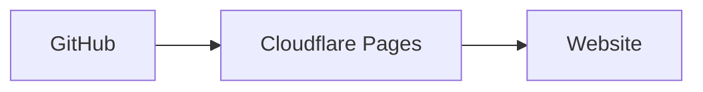

# rameshkannan.github.io

## Website overview

The site is built and hosted on Cloudflare Pages from this GitHub repository. Cloudflare also manages DNS for the domain.

See [Project setup](PROJECT_SETUP.md) for the technologies, local development commands, deployment, and analytics configuration.

## Search engine indexing

The static build generates `/robots.txt` and `/sitemap.xml`; the sitemap includes the home page, blog index, and published blog posts. The About page is intentionally left out of public navigation and the sitemap for now. After deployment, verify both URLs are publicly accessible and submit `https://rameshkannan.com/sitemap.xml` in Google Search Console and Bing Webmaster Tools.

## Google Tag Manager

Set `NEXT_PUBLIC_GTM_ID` to the GTM container ID in the local environment and deployment settings. It must be available during the Next.js build; changing it requires a rebuild. When set at build time, the GTM container loads.

In GTM, configure a Google tag for your GA4 measurement ID and leave automatic `page_view` sending enabled. In the GA4 web data stream's Enhanced Measurement settings, enable **Page changes based on browser history events** to track client-side navigation. Do not add a separate Custom Event tag for `page_view`, as it would duplicate the automatically collected events.
